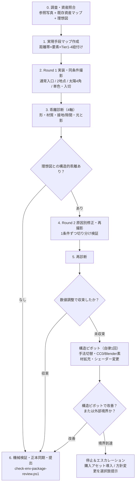

# 環境パッケージ制作・品質収束・資産再利用パイプライン（DS-015）

- **作成日**: 2026-11-28
- **ステータス**: active（全環境パッケージ共通の制作・検証・自律収束手順）
- **対象**: 砂岩・草原・海岸・洞窟・森林/密林/自然公園・現代/中世/未来都市・道路・水・天候など、見た目を含むすべての環境パッケージ制作
- **関連仕様**: [OPERATOR_WORKFLOW.md](../OPERATOR_WORKFLOW.md) / [REPO_LOCAL_RULES.md](../REPO_LOCAL_RULES.md) / [DS-011 Props カタログ](ENVIRONMENT_PROPS_CATALOG_SPEC.md) / [DS-012 テクスチャパイプライン](TEXTURE_PIPELINE_SPEC.md) / [DS-013 水環境](COASTAL_WATER_SPEC.md) / [DS-014 自然地形](NATURAL_ENVIRONMENT_PACKAGES_SPEC.md)

---

## 1. 解決する4つの構造的課題

2026-11-25〜28 の環境パッケージ制作（砂岩・草原・海岸・森林・自然公園・現代都市）で繰り返し発生した構造的問題を、全パッケージ共通の標準手順と機械チェックで解消する。

| 構造的課題 | 観測された症状 | 本パイプラインでの構造的対策 |
|---|---|---|
| **理想図と実機の乖離** | 生成画像・参照写真ベースの理想図に対し、Unity 実機が C# 頂点カラー球や Box/Tube プリミティブ合成のままで質感がかけ離れる | 制作前に**要素分解→実現手段マップ（§3）**を必須化。プリミティブ／頂点カラー単色の最終表現利用を禁止し、PBR・実アセット・専用シェーダーへ事前に紐付ける |
| **促さないと進まない** | 1回の試作・撮影後に「残る差は〇〇」と書いて停止し、ユーザーの催促なしに次巡の改善へ進まない | **自律収束ループ（§4）**を標準化。承認済み方向内では最低2巡（試作→原因切り分け→構造修正→再撮影）＋必要時の1構造ピボットまで自律完遂する |
| **ループが全体で安定しない** | 砂岩版・草原版・Mission Packet に手順が散在し、実行漏れを検知する手段がない | 本書を単一の正本とし、`package-review.json` と `scripts/check-env-package-review.ps1` で返却前に機械検証する（§5） |
| **他成果を再利用できず力押しになる** | 既存の共有 PBR・シェーダー・FBX 71種・購入済みアセットを調べず毎回ゼロから手続き生成し、ポリゴン増量（数百万三角）や数値微調整で力押しする | 着手前の**共有資産インベントリ照合（§2）**を必須化。再利用優先順位（既存資産→CC0/Blenderベイク→購入済み候補→手続き生成）を固定する |

---

## 2. 共有資産・手法の再利用優先順位とインベントリ

新しい環境パッケージで要素を作る前に、必ず次の優先順位で実現手段を選ぶ。上位で解決できる要素を下位（特に C# 手続きメッシュ）で力押ししない。

1. **Tier 1（最優先）: リポジトリ内の既存共有資産・シェーダー・パッケージ**
2. **Tier 2: CC0 外部素材（Poly Haven / ambientCG）の取り込み・Blender ベイク（[DS-012](TEXTURE_PIPELINE_SPEC.md) 準拠）**
3. **Tier 3: 所有済み Unity アセットの検証・採用提案**（導入は `Packages/`・`Assets/` 変更を伴うため、採用判断時のみ根拠付きで本人へ提示）
4. **Tier 4（最後）: 新規 C# 手続きメッシュ／専用シェーダー**（地形骨格・配置ロジック・既存資産の合成に限定。リアル調の細部形状や質感を頂点カラー単色メッシュで代用しない）

### 2.1 リポジトリ内の再利用可能資産クイックマップ

| 区分 | 置き場所・代表ファイル | 再利用できる内容 | 適用先の例 |
|---|---|---|---|
| **地形表面 PBR** | `Assets/Resources/RegionMap3D/Surfaces/`（`Cliff`, `Crust`, `Deposit`, `Mudstone`, `Sand`, `Talus`, `Wash`） | 1K/2K の写真 PBR（色・法線・粗さ・高さ）と `RegionSurfaceImport` 規則 | 海岸岩盤・崖・砂浜・林床・公園の土・道路路肩 |
| **共通シェーダー / HLSL** | `Assets/Resources/RegionMap3D/`（`RegionAtmosphere.hlsl`, `RegionShadows.hlsl`, `RegionSurfaceMaterials.hlsl`, `RegionBiomeSurface.hlsl`, `RegionProp.shader`, `RegionTerrain.shader`） | Linear 色空間の霞・GPU 遠距離影・トライプラナー・上面堆積（砂塵/苔/雪）・接地スカート | 全 3D 環境の空・霞・影・地形・Props の見た目統一 |
| **環境 Props FBX (71+)** | `Assets/Art/Models/`（`NAT`, `RUB`, `STR`, `CNT`, `SET`, `EXP`）＋ `Assets/Art/Textures/` ＋ `RegionPropAssets.cs` | LOD0/LOD1 付き FBX（層状岩・丸礫・流木・岩屑・木箱・樽・柵・瓦礫等）と共有 PBR マッピング | 海岸・洞窟・森林・草原・都市・道路の近景接地と密度 |
| **植生アトラス / ベイク** | `Assets/Resources/RegionMap3D/MeadowTussocks.png`, `DesertPlants.png`, `scripts/bake-meadow-tussocks.py`, `scripts/bake-region-plants.py` | Blender で CC0 3D 植物を多方向投影ベイクした切り抜きアトラスと配置 JSON | 草原・自然公園・砂丘・林縁・路肩の下草・低木 |
| **水環境パッケージ** | `Packages/com.vastcore.water/`（`ShoreContact.shader` 等）＋ [DS-013](COASTAL_WATER_SPEC.md) | 波面・岸の接触・泡・濡れ帯の共通表現 | 海岸 A/B/C・湖・川岸・港湾・水辺公園 |
| **天候・空・霧** | `Packages/com.vastcore.weather/` ＋ `RegionWeatherMaker.cs`（Weather Maker 連携）＋ `RegionCloudLayer.cs` | 2D 地図と整合する雲・谷霧・太陽高度・大気霞 | 全 3D 環境の空・天候・遠景の奥行き |
| **建築・街区キット** | `Assets/Art/ModernCity/` | 建物・店舗・街路のモジュラー構成と検証ルート（ただし最終質感は単色プリミティブに留めず PBR/実素材へ差し替えること） | 現代都市・郊外・施設 |

### 2.2 所有済み Unity アセット候補（導入前に必ず照合）

`C:\Users\PLANNER007\Unity_Rendering_Assets_2026-11-26.csv` に記録された購入済みアセットのうち、リアル調の環境制作で自作の力押しを大幅に減らせる主要候補：

| 領域 | 購入済みアセット候補 | 活用検討のタイミング |
|---|---|---|
| 空・大気・霧 | `Weather Maker`（導入済み）, `UniStorm`, `Ethereal URP` | 空・雲・ボリュメトリック霧の表現が自作で不足するとき |
| 水面・流体 | `Oceanis 2024 Pro URP Water Framework`, `FLOW` | 海岸・湖・川の反射/屈折/波面が自作シェーダーで不足するとき |
| 植生・森林 | `Environment Vegetation - Bundle`, `Nature Package - Forest Environment`, `Lake Coniferous - Environment`, `Ultimate Foliage Renormalizer` | 樹木・葉群・草株が手続きメッシュでチープになるとき（最優先の検討対象） |
| 道路・地形補助 | `EasyRoads3D Pro Add On - HD Roads`, `Path Painter II`, `Terrain Composer 2` | 道路の接地・路肩ブレンド・小道表現で力押しになりそうなとき |
| 材質・接地・GI・LOD | `Lux URP Essentials`, `Decalery`, `HTrace: SSGI URP`, `Ultimate LOD System MT` | 接地馴染ませ（デカール）、屋内/林内の間接光、LOD/インポスター自動生成 |

> **境界**: 未導入の有料アセットをリポジトリへ追加する操作は `Packages/` / `Assets/` 境界変更にあたるため、勝手に導入せず「自作 vs CC0 vs 所有済みアセット導入」の比較と根拠を示して本人の承認を得る（git へ有料アセット本体は入れない）。

---

## 3. 着手前設計：理想図→実現手段マップ（Visual-to-Asset Decomposition）

コードを書く前に、**「理想図に描かれたリアルさを、Unity 内で具体的にどの資産と技術で出すか」**を距離帯ごとに分解する。これを省略して実装に入らない。

### 3.1 距離帯ごとの支配要因（やってはいけない代替）

| 距離帯 | 画を決める支配要因 | 効かない力押し（禁止パターン） |
|---|---|---|
| **遠景（400 m〜）** | シルエット・大きな塊の明暗・大気霞の段差 | 遠景に細かな高ポリ植生やノイズテクスチャを貼る |
| **中景（60〜400 m）** | 数 m〜数十 m の構造（段・割れ目・群落の塊・建築ボリューム）＋大周期の材質・影 | 地面に緑や茶色を塗って植生や岩の代わりにする／同じ形の等間隔反復 |
| **近景（0〜60 m）** | 実寸 PBR 材質（法線・粗さ・AO）・実形状の FBX/ベイク葉群・接地スカート・小礫/落葉の遷移 | C# の頂点カラー単色メッシュ、UV なし Box/Tube/球の合成でリアル調を狙う |

### 3.2 実現手段マップ（実装前チェック表）

各環境パッケージの着手時、最低限以下の列を埋めて `package-review.json` の `realizationMap` に記録する。

| 距離帯 | 理想図で読めるべき要素 | 実現手段（Tier 1〜4 を明記） | 使う資産・シェーダー・素材 | リスク（乖離しやすい点） |
|---|---|---|---|---|
| 遠 | 例：岬と入り江の輪郭、奥行き霞 | Tier 1: 高さ場 + `RegionAtmosphere.hlsl` | 既存高さ場・霞シェーダー | 遠景のコントラスト過多 |
| 中 | 例：樹冠の群落と切れ間、崖の節理 | Tier 2: CC0 樹冠カード/FBX 群落 | Poly Haven / Blender ベイク | 単調な球体・反復配置 |
| 近 | 例：落葉・小礫・濡れ岩の接地 | Tier 1+2: 既存 PBR + DS-011 FBX | `Surfaces/` + `NAT`/`RUB` FBX | 浮き・継ぎ目・テカリ過多 |

- **プリミティブ／単色禁止ゲート**: `realizationMap` の近景・中景に「C# 頂点カラー単色メッシュ」や「UV・PBR なしの Box/Tube 合成」が残っている場合、実装に進んではならない。先に Tier 1（既存資産）または Tier 2（CC0＋Blender ベイク）の調達・差し替えを設計に含める。

---

## 4. 自律収束ループ（促され待ちを無くす実行規約）

方向が既定または承認済みの環境パッケージでは、**1回の試作・撮影で止まらず、以下のループを自律で完遂してからユーザーへ提出する**。



*図の説明*: 角丸は通常工程、ひし形は判定分岐。Round 1 で止めず、最低 Round 2（必要時は構造ピボット 1 回）まで自律で回し、検証スクリプト通過後に提出する。

### 4.1 自律継続ルール（いつ進み、いつ止めるか）

- **止めてはいけない場面（自律で続行する）**:
  - 単色での形・接地確認が終わったとき（確認は開発 AI 自身の診断として行い、そのまま材質・植生・光の工程へ進む）
  - Round 1 の試写で理想図との乖離（のっぺり・隙間・葉が太い・接地浮き・反復・暗すぎ/明るすぎ）が見つかったとき
  - 既存の CC0 取得経路・Blender ベイク・DS-011 FBX 再利用・シェーダー修正で直せる不足が見つかったとき
  - テスト通過・比較ページ生成・正本更新・commit/push の前後
- **止めてユーザーへエスカレーションする3条件のみ**:
  1. **外部・契約境界**: 未導入の購入済み Unity アセット導入、`Packages/` 変更、破壊的変更、GPU 予算（1600×900 で地形増分 1.2 ms 等）の前提変更が必要なとき。
  2. **未確定の美術方向**: 初回の大きな方向分岐（2〜3の異なるアプローチから選ぶ必要があるとき）。※ただし方向に依存しない調査・基準撮影は先に完了させる。
  3. **構造ピボット後の未収束**: Round 1 → Round 2 → 構造ピボット（素材/手法の切替）を自律で実行しても理想図との乖離が解消できず、制作方針や外部素材調達経路の変更が必要なとき。

### 4.2 乖離診断の4軸（Round 1 → Round 2 で必ず実施）

初回の試写と理想図を同じ構図・目の高さで並べ、次の4軸で原因を切り分ける。**「残る差」を文章で書くだけで終わらせず、特定した主因を Round 2 で修正する。**

1. **形とシルエット**: 材質・植生を切った単色画（または幅 200 px 縮小）で、遠・中の塊と段差が理想図どおり読めるか。
2. **材質と質感**: PBR 法線・粗さ・実寸（`tileMetres`）・鏡面抑制が効いているか。単色塗りやプラスチック光沢になっていないか。
3. **接地・隙間・反復**: 足元視点と見下ろし視点、および立体物の入切差分で、浮き・隙間・帯状の露出・等間隔の反復を検出し潰す。
4. **光・影・空気**: 太陽高度 4 条件（60/38/20/10°）と 2 地点で、影の破綻・不自然な暗部・空と霞の不整合（`RegionAtmosphere` / `Weather Maker` との乖離）がないか。

### 4.3 撮影・計測の統一基準

- **入口**: 必ず通常の Unity メニュー／探索入口から開いて確認する（バッチ専用シーンだけの確認で閉じない）。
- **比較条件**: 前（HEAD または Round 1）と後（最終版）で、カメラ位置・FOV・seed・太陽高度・天候・波/風の時刻を完全一致させる。
- **比較ページ**: `D:\AI-Runs\VastCore\<作業名>\index.html` の1か所に「参照写真（出典付き）・完成想定図・Unity 前後・通常入口画面・計測（構築時間・三角形数・GPU 時間）」を並べる。

---

## 5. 機械検証ゲート（`package-review.json` と検証スクリプト）

環境パッケージの返却前・commit 前に、レビューディレクトリ（`D:\AI-Runs\VastCore\<作業名>\`）へ `package-review.json` を出力し、以下を実行して通過させる。

```powershell
.\scripts\check-env-package-review.ps1 -ReviewDir "D:\AI-Runs\VastCore\<作業名>"
```

### 5.1 `package-review.json` 最小スキーマ

```json
{
  "packageId": "woodland-temperate-forest",
  "specPath": "docs/02_design/NATURAL_ENVIRONMENT_PACKAGES_SPEC.md",
  "entryMenu": "Vastcore > Region Map > Woodland Samples > Forest",
  "references": [
    { "range": "mid", "source": "https://...", "takeaways": ["樹冠の塊", "林床の落葉層"] }
  ],
  "targetConceptImage": "target.png",
  "unityBeforeImage": "before/mid-38.png",
  "unityAfterImage": "after/mid-38.png",
  "reusedAssets": [
    { "tier": 1, "path": "Assets/Resources/RegionMap3D/RegionAtmosphere.hlsl", "role": "遠景霞と光" },
    { "tier": 1, "path": "Assets/Art/Models/NAT/nat_dry_root_log/", "role": "倒木 Props" }
  ],
  "realizationMap": [
    { "range": "far", "element": "樹冠の群落と切れ間", "tier": 2, "method": "CC0ベイク樹冠クラスタ", "primitiveFallback": false },
    { "range": "near", "element": "林床と落葉の接地", "tier": 1, "method": "Poly Haven Forest Floor PBR + DS-011 FBX", "primitiveFallback": false }
  ],
  "iterations": [
    {
      "round": 1,
      "diagnosis": "中景の樹冠が球状で隙間が目立ち、林床が単色に見える",
      "action": "単色・入切で原因を切り分け、CC0 葉群ベイクと Forest Floor PBR へ差し替え",
      "structuralPivot": true,
      "improved": true
    },
    {
      "round": 2,
      "diagnosis": "道脇の落葉境界が直線的",
      "action": "路肩の段差と落葉ブレンド幅を広げて再撮影",
      "structuralPivot": false,
      "improved": true
    }
  ],
  "metrics": {
    "buildMs": 990,
    "triangles": 1840000,
    "gpuMs": null,
    "gpuBudgetNote": "PC Player 計測待ち"
  },
  "remainingGaps": [
    "遠景の丘の霞コントラスト微差"
  ],
  "stopReason": "converged"
}
```

### 5.2 検証スクリプトが拒否（FAIL）する条件

- 必須フィールド欠落、または `targetConceptImage` / `unityBeforeImage` / `unityAfterImage` のファイルが存在しない
- `references` が空（出典なき制作）
- `reusedAssets` が空（既存資産の調査・再利用を行っていない）
- `realizationMap` に `far` / `mid` / `near` のいずれかが欠けている、または `primitiveFallback: true` が正当な理由（`fallbackReason`）なしに残っている
- `iterations` が 2 巡未満（ただし `stopReason` が `"converged_round1"` かつ `remainingGaps` が空の場合のみ 1 巡を許容）
- `stopReason` が許可値（`converged`, `converged_round1`, `escalated_boundary`, `escalated_direction`, `escalated_after_pivot`）以外
- `stopReason` が `escalated_after_pivot` なのに `iterations` に `structuralPivot: true` の記録がない（数値微調整だけで諦めた）
