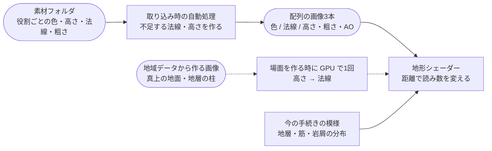

# 地域の3D地形の表面材質と自動の凹凸（設計）

[SP-021](REGION_MAP_EXPLORATION_SPEC.md) の3D砂岩（[見え方の想定](REGION_TERRAIN_LOOK_SPEC.md)）の表面を、写真の素材へ差し替えられるようにし、画像から凹凸（法線）を自動で作って陰影を付ける設計。重さの予算と、作る順を持つ。どの素材を使うか（絵の採否）は本人が決め、開発担当は差し替え口・自動生成・候補の提示までを作る（[INVARIANTS](../INVARIANTS.md)）。

本人原文（2026-11-26、チャット）:

> このプロジェクトのテクスチャについてより洗練したものに入れ替えたいです。これについて調査して開発設計してください。

> また可能ならテクスチャから自動的にバンプマップ生成したりして陰影を付けるシステムを構築して欲しいです。これは重くならないよう全体的な設計との相談になります。

対象は3D砂岩の場面（`view3d`）。探索画面・鳥瞰図の2Dの絵（CPU で画素を描く）と、保留中の旧 MapGenerator の地形は対象外（開発担当の仮定）。

## 1. 現状（2026-11-26 の現物）

| 部分 | 今の描き方 | 絵で見える弱さ（[近景](../../artifacts/region-map/atmosphere-20261126/v4-gamma/clear/look-near.png)・[中景](../../artifacts/region-map/atmosphere-20261126/v4-gamma/clear/look-mid.png)、撮影端末のみ） |
|---|---|---|
| 崖の岩肌・地層 | [RegionSandstone.hlsl](../../Assets/Resources/RegionMap3D/RegionSandstone.hlsl) が色だけを手続きで計算（ノイズ・縞・黒い筋）。画像は0枚 | 縞が面に描いた線に見える。光は大きな形の起伏にしか反応せず、布を垂らしたような滑らかな陰になる |
| 地面（砂・土・岩屑・地被） | 同じ手続きの色と、地域データから描いた真上の画像 `_BaseMap`（1画素 約1 m／5.9 m） | 粒・礫は色の点で、光が当たっても凹凸が出ない |
| 転石 | 同じシェーダーの `_LooseRock`。平らな面、UV なし | 1つの岩が単色の板の集まりに見える |
| 光 | [RegionTerrain.shader](../../Assets/Resources/RegionMap3D/RegionTerrain.shader) は頂点の法線で拡散光だけ。法線マップ・粗さ・鏡面は無い | 細かい陰影が無い原因 |
| 植生 | `DesertPlants.png` のアトラス | この設計の対象外 |

写真素材は ambientCG の Ground054・Ground081（1K、CC0、`Assets/Resources/MapGenerator/Textures/`）が既にあり、5.2節の試験で「法線・粗さを加えると粒に光が当たる」「鏡面を18%にすると照りが弱まり粒の陰影は残る」ことを確かめた。通常の表示には入っていない。

## 2. 方式の比較

| 方式 | 何が変わるか | 素材の準備 | 実行時の重さ | 残る弱さ |
|---|---|---|---|---|
| **A 写真素材＋手続きの大きな模様（推奨）** | 地層の並び・黒い筋・岩屑の分布など、場所で決まる大きな模様は今の手続きのまま。1 m 以下の粒・割れ・凹凸を写真素材の色・法線・粗さに替える | 役割ごとに素材を1組選ぶ（CC0 はリポジトリ、有料は git の外） | 近くで1画素あたり最大12回の画像読み（3節）。遠くは今と同じ | 素材の繰り返し。写真の照明の焼き込み |
| B 手続きのまま凹凸だけ足す | 画像を使わず、今の縞・粒・礫の式から法線を作る | 不要 | 式を数回評価し直すので、近くで今の2〜3倍の計算 | 写真らしさは増えない。粒の形は今の式のまま |
| C 岩面の形状部品を置く | 崖の近くに実寸の岩面のメッシュを並べる（[5.4節](REGION_TERRAIN_LOOK_SPEC.md#scene-workflow) の案） | 部品の寸法・接地・軽い形の用意 | 三角形の数が増える | テクスチャの問題ではなく形の作業。A と組み合わせる後続 |

推奨は A。理由は、本人の目標「UEで作成したシーンのようなリアルなもの」（2026-11-25）に向けて、5.2節で効果が出た方向であり、B の凹凸の仕組み（4節の地層の柱）も A の中で使えるため。A と B のどちらでも、4節の自動の凹凸は共通に使う。

## 3. 構成

図は、素材を置いてから画面に出るまでの流れ。四角は処理、角丸は置かれる物、点線は場面を作るたびの処理。

### 3.1 素材の差し替え口

役割は6つ。素材は `Assets/Resources/RegionMap3D/Surfaces/<役割>/` に置き、実寸（m）と向きを1つの設定（ScriptableObject）に持つ。置かれていない役割は今の手続きの色で描く（素材が無い環境・有料素材を置けない公開リポジトリでも動く。空と霞の Weather Maker と同じ扱い）。

| 役割 | 今の描き方 | 候補（開発担当の提示。採否は本人） |
|---|---|---|
| 崖の岩肌（帽子の砂岩） | 手続きの赤橙と縞 | [Red Sandstone Wall](https://polyhaven.com/a/red_sandstone_wall)（CC0、2 m）、[Sandstone Cracks](https://polyhaven.com/a/sandstone_cracks)（CC0、2 m） |
| 泥岩の帯 | 手続きの灰紫 | 未調査 |
| 岩屑 | 手続きの礫と色 | Ground081（CC0、礫。所有済み） |
| 砂と土 | 手続きの砂色 | Ground054（CC0、砂。所有済み） |
| 地被（生物土壌クラスト） | 手続きの暗い斑 | 未調査 |
| 転石 | 単色の板 | [Rock Face 03](https://polyhaven.com/a/rock_face_03)（CC0、2.7 m）、崖と同じ素材 |

素材の色は場所の模様で着色し直す（色の画像は明るさの細部として使い、色相は今の手続きの地層の色を保つ）。地層の連続と鉄分の色の違いは場所で決まるため、写真の色をそのまま貼らない。

### 3.2 自動の凹凸（バンプ）の作り方

| 入力 | いつ作るか | 実行時の重さ | 方法 |
|---|---|---|---|
| 法線マップのある素材 | 取り込み時 | 読み1回 | そのまま使う。Unity は OpenGL 向き（緑が上）なので NormalGL を選び、DX 版しか無ければ緑を反転する |
| 高さ（Displacement）だけある素材 | 取り込み時 | 読み1回 | Unity の取り込み設定 Create from Grayscale（Bumpiness、Sharp/Smooth）で法線にする（[Unity の法線マップの取り込み](https://docs.unity3d.com/Manual/texture-type-normal-map.html)） |
| 色の画像だけの素材 | 取り込み時 | 読み1回 | 自作の Editor 処理。明るさを取り、実寸 0.5 m 程度のぼかしとの差で写真の大きな明暗を除き、半径の違う Sobel を重ねて法線にする。同じ高さを高さの画像にも書く。色から作る高さは推定（影と凹みを取り違える）なので、高さのある素材を優先する |
| 地域データから作る画像（真上の地面） | 作らない | — | 乾いた陸では砂岩の色がこの画像を置き換える（`RegionTerrain.shader` の `surface.w`）ので、凹凸を作っても見える所がほぼ無い（段1で確認、2026-11-26） |
| 手続きの地層（層の境・層ごとの硬さ） | 場面を作る時に1回 | 読み1回 | 色の縞と同じ式から起伏（m）を1次元の画像に焼き（384 m を 8192 画素）、Sobel で傾きにする。崖の面では法線を上下に傾け、硬い層が張り出し、層の境が溝になる |
| 手続きの斜交葉理（細い斜めの縞） | 焼かない | 読み0回 | 明るい縞を高さ 6 cm の稜とし、縞の式の勾配から解析的に傾ける。縞が画素より細くなると消す |

取り込み時の処理は `AssetPostprocessor` で、フォルダに置くだけで動く。作った画像は役割ごとに `Texture2DArray` へまとめる。

### 3.3 重くしない仕組み

| 手段 | 内容 |
|---|---|
| 画像を束ねる | 全役割の色・法線・高さ粗さAO を配列3本にする。役割を増やしても、結び付ける画像の数と描画の回数は変わらない |
| 投影を減らす | 平らな地面は真上から1回。崖と転石は biplanar（2回）を使い、triplanar（3回）は使わない。biplanar は向きの切り替えで mip の線が出るので、勾配を渡して読む（[Quilez の biplanar](https://iquilezles.org/articles/biplanar)） |
| 混ぜる数の上限 | 1画素で混ぜる役割は重みの大きい2つまで |
| 距離の段 | 近（約60 m まで）は色・法線・高さ粗さAO。中（約400 m まで）は色と法線を大きい周期で。遠は写真を読まず、今の手続きの色と地層の柱だけ。境は距離の連続した分岐なので画面の中でまとまる。距離は推定で、計測で決める |
| 繰り返しを崩す | 割れ目の板ごとに UV をずらして回す（板の番号を頂点に持たせる。割れ目は [RegionDetailMesa.cs](../../Assets/Scripts/RegionMap/Core/RegionDetailMesa.cs) が決めている）。周期の違う2つの色を掛ける。読みが3回になる確率的タイル（stochastic）は使わない |
| 圧縮と解像度 | 色 BC7、法線 BC5、高さ粗さAO BC7。配列は1本の中で同じ大きさが要るので 2K に揃える。品質設定の mip の上限で 1K に落とせる |
| メモリ | 2K の BC7・BC5 は mip 込みで1枚 約5.3 MB。6役割×3種で 約96 MB（1K に落とすと 約24 MB）。開発機の GPU は RTX 4060 Ti 8 GB |
| 光 | 粗さが入るので URP の鏡面を使う。乾いた砂岩は鏡面を弱める（5.2節の 18% を初期値にする） |

予算（開発担当の仮の値。本人が変えられる）: Standalone の PC 品質・1600×900・固定の遠中近とアルコーブ近景で、地形の描画の GPU 時間の増分を 1.0 ms 以下。計測は同じ版の前後で、Unity の `FrameTimingManager` か Profiler の GPU 時間で取る。

### 3.4 変えるファイル

- シェーダー: `RegionTerrain.shader`（法線・鏡面・距離の段）、`RegionSandstone.hlsl`（地層の柱を読む形へ）、新規の `RegionSurfaceMaterials.hlsl`（配列の読み、biplanar、混合）。
- C#（`Vastcore.RegionMap` の View）: `RegionTerrainView.cs`（配列と地層の柱を結び付け、板の番号の頂点の値）、新規の素材設定。Core は板の番号を返す関数だけ足す。
- C#（`Vastcore.RegionMap.Editor`）: 新規の取り込み処理（法線・高さの生成と配列化）。
- `ProjectSettings/`・`Packages/` は変えない。

## 4. 作る順と完了条件

| 段 | 作るもの | 完了条件 |
|---|---|---|
| 1 自動の凹凸（素材なしで確かめられる部分） | 地層の柱の1次元画像と、その高さからの法線。斜交葉理の稜。崖の面と転石の細かな起伏（仮の高さの画像、一辺 4 m） | 同じ視点・光の前後で、崖の層の境に陰が付き、転石の面に明暗の変化が出る。GPU 時間の増分を記録 |
| 2 差し替え口と取り込み | 6役割のフォルダ、取り込み時の法線・高さの生成、配列化、素材なしの時の今の描き方 | 所有済みの Ground054・Ground081 と、色の画像だけの素材1つで、フォルダに置くだけで表示が変わる。外すと今の絵に戻る |
| 3 重さの仕組み | 距離の段、biplanar、上位2つの混合、板ごとの UV、鏡面 | 予算内。遠景が今の絵と同じ見え方を保つ |
| 4 素材の採否 | 候補を並べた確認ページ（同じ視点・4つの太陽の高さ・seed 9 と 8） | 本人が役割ごとに素材を選ぶ。選ばれた素材で撮り直す |

段1・2・3 は素材の選択に依存しない。段4 は本人の選択を待つ。

**段1の結果（2026-11-26、Unity 6000.3.6f1、seed 9、clear、写し `D:\vcv\VastCore`）。** [RegionSurfaceRelief.cs](../../Assets/Scripts/RegionMap/View/RegionSurfaceRelief.cs) が場面を作る時に [RegionReliefBake.shader](../../Assets/Resources/RegionMap3D/RegionReliefBake.shader) で高さ→傾きを焼き、[RegionSandstone.hlsl](../../Assets/Resources/RegionMap3D/RegionSandstone.hlsl) の `SandstoneReliefNormal` が光を受ける向きを傾ける（影の計算と岩肌の判定は形の法線のまま）。

同じ場面で切／入を切り替えて撮った。アルコーブ中景で層の境に溝の陰、手前の段の斜めの縞に稜の明暗が出た（画素の 20.5% が変化）。近景の崖と転石は 10〜11%、遠景は 1.3%。描画1回の時間（GPU の終わりまで、MSAA4、各48回の中央値）の差は 1600×900 で −0.27〜+0.26 ms（揺れの範囲）、GPU が律速の 3840×2160 で +0.10〜+0.91 ms（近景が最大。画素数で 1600×900 に直すと 約0.16 ms）。予算 1.0 ms の内。

値のノイズの等高線で作った割れ目は、閉じた丸い線の網に見えたので外した。比較画像は撮影端末の `artifacts/region-map/relief-20261126/v3/`。再現は `.\scripts\region-map.ps1 -Mode view3d -Seed 9 -ReliefCompare -OutDir <出力>`（`<出力>/relief-off/` と `relief-timing.txt`）。見た目の採否は本人。層の境の溝は細く均一で暗く、手前の稜はやや規則的（強さは `RegionSurfaceRelief.StrataStrength`）。

## 5. 未確認

- 地層の柱へ置き換えた時に、今の縞の見え方（5.1節 N1）が保てるか。
- 色の画像だけから作る高さの質（写真の影の取り違え）。
- 距離の段の境が、移動中にちらつかないか（Player 未計測）。
- Weather Maker の霞が、このシェーダーの鏡面にどう掛かるか（組み込みは写し `D:\VastCore-sky-trial` で進行中）。
- 泥岩の帯と地被の CC0 候補。
- 段1の凹凸の、seed 8 などの別地点・golden と dust の光・Player での見え方と GPU 時間（計測は Editor のバッチ描画）。
