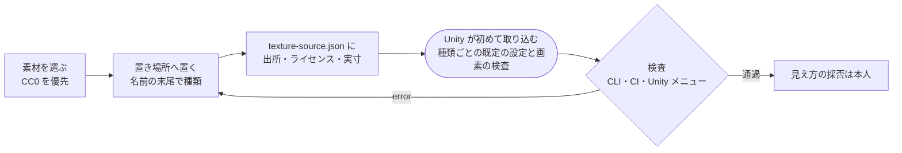

# テクスチャの準備と品質の規則（DS-012）

プロジェクトのテクスチャを用意する時に、置き場所・名付け・出所・取り込みの設定・画素の質をそろえる仕組み。規則の表は [texture-rules.json](texture-rules.json) の1か所で、Unity の取り込み・Unity 内の検査・Unity を使わない検査（CLI と CI）が同じコード（[Shared](../../Assets/Scripts/TexturePipeline/Editor/Shared/)）で読む。どの素材を使うか（絵の採否）は本人が決め、この仕組みは採否の前に技術的な欠陥を落とす。

本人原文（2026-11-27、チャット）:

> このプロジェクトのテクスチャを用意するための作業について、プロジェクト全体でクオリティが保たれるよう各種パイプラインなど整備してください。

## 1. 流れ

図は、素材を選んでから画面で使えるまで。四角は人の作業、角丸は自動の処理、ひし形は合否。



## 2. 置き場所

| 場所 | 規則の名前 | 状態 | 取り込みの設定を決めるもの | 上限など |
|---|---|---|---|---|
| `Assets/Resources/RegionMap3D/Surfaces/<役>/` | terrain-surface | active | [RegionSurfaceImport](../../Assets/Scripts/RegionMap/Editor/RegionSurfaceImport.cs)（[表面材質の設計](REGION_SURFACE_MATERIALS_SPEC.md) 3.1節） | 元は PNG・JPG、git には辺 2048 まで、作る3枚は 1024、256 px/m 以上 |
| `Assets/Resources/RegionMap3D/` | region-3d | active | この仕組みの既定 | 取り込み 2048、mipmap と圧縮が必須 |
| `Assets/Art/` | art | active | この仕組みの既定 | 取り込み 2048、mipmap と圧縮が必須、128 px/m 以上。DS-011 の Props の材質はここに置く（`Assets/Art/Textures/<ドメイン>/<組>/`） |
| `Assets/Resources/MapGenerator/`・`Assets/_Textures/` | legacy-* | legacy | 既存の設定のまま | 指摘は info。保留中の経路なので直さない |
| `Assets/Scenes/` | baked-lighting | ignored | Unity の焼き込み | .meta の有無だけ |
| それ以外の `Assets/` | other | active | この仕組みの既定 | 取り込み 2048、圧縮が必須 |

`Assets/WeatherMaker/`（有料、git の外）・`Assets/TextMesh Pro/`・`Assets/Plugins/` は第三者の資産なので見ない。`Resources/` の下の画像はすべて実行ファイルに入るので、使わない元の画像は `Resources/` の外へ置く。

## 3. 素材を足す手順

1. 素材を選ぶ。CC0（ambientCG・Poly Haven）を優先する。CC-BY は author を書けば使える。有料の素材と出所の分からない画像は git に入れない。
2. 種類はファイル名の末尾で決まる: `_Color`・`_diff`（色）、`_NormalGL`・`_nor_gl`（法線）、`_NormalDX`・`_nor_dx`（DX の法線）、`_Displacement`・`_disp`、`_Roughness`、`_AmbientOcclusion`・`_ao`、`_arm`、`_Metallic`、`_Opacity`・`_mask`、`_Emission`。表は texture-rules.json の `kinds`。法線は GL 版を置く（Unity は緑が上）。
3. 使う解像度へ縮めてから置く（地形の表面は 1K、Props は 1K〜2K、2の冪）。大きい元は git の外（各端末の作業場所）に残し、取得元の URL を記録に書く。
4. 同じフォルダか上のフォルダに `texture-source.json` を置く。

   ```json
   { "sets": [ { "files": ["Ground054*"], "origin": "downloaded", "source": "https://ambientcg.com/view?id=Ground054",
     "license": "CC0-1.0", "author": "ambientCG", "retrieved": "2026-11-27", "tileMetres": 2, "notes": "" } ] }
   ```

   `origin` は downloaded（`source` に URL）・generated（`generator` にこのリポジトリの道具のパス）・original（手で作った物）。`license` は CC0-1.0・CC-BY-4.0・project。`tileMetres` は繰り返す素材の横1枚の実寸（m）で、画素密度の検査に使う。

5. Unity で開く。`.meta` が無い画像（初めての取り込み）には、場所と種類から sRGB・Normal map の型・DX の緑の反転・mipmap・aniso 4・最大の辺・圧縮（色と法線は CompressedHQ）・Read/Write 切が入り、画素の検査の指摘が Console に出る。既にある画像の設定は変えない（直す時は画像を選んで `Vastcore/Textures/Apply Import Rules To Selection`）。
6. `.\scripts\check-textures.ps1` を通してから、画像と `.meta` と記録を一緒に commit する。

## 4. 検査

### 4.1 指摘の code

| code | 重さ | 内容 |
|---|---|---|
| TX000 | error | 規則の表が壊れている |
| TX001 | error | `.meta` が無い |
| TX002 | error | 出所の記録が無い |
| TX003 | error | 記録の不備（使えないライセンス、CC-BY の author、downloaded の URL、generated の道具） |
| TX004 | error | sRGB が種類と合わない（データの画像が sRGB、色の画像が Linear） |
| TX005 | error | 法線が Normal map 型でない、または法線でない画像が Normal map 型 |
| TX006 | error | DX の法線を緑の反転なしで使っている |
| TX007 | warning | 2の冪でない（mip と圧縮が崩れる） |
| TX008 | error | 取り込みの最大の辺が場所の上限を超える |
| TX009 | warning | git に置く元の画像が大きすぎる |
| TX010 | warning | 圧縮しない設定 |
| TX011 | warning | 3D に貼る画像の mipmap が切 |
| TX012 | warning | 同じ中身の画像が2つ |
| TX013 | warning | 名前から種類が分からず、取り込み（RegionSurfaceImport）で使われない |
| TX014 | error | 地形の表面の役のフォルダの外、または役に色の画像が無い |
| TX015 | error | その場所で使えない形式 |
| TX016 | warning | Read/Write が入（メモリが倍） |
| TX017 | warning | 画素密度が下限より粗い（`tileMetres` があるときだけ） |
| TX018 | warning | 同じ役に同じ種類の画像が2つ |
| TX019 | warning | 縦横の比が整数倍でなく、正方形へ引き伸ばされる |
| TX020 | warning | TextureImporter 以外で取り込まれ、設定を検査できない |
| TQ101 | warning | 繰り返しの継ぎ目が見える |
| TQ102 | warning | 色の画像の白飛び・黒つぶれ |
| TQ103 | warning | 色の明るさの範囲が目安の外（影や照りの焼き込み） |
| TQ104 | warning | 場所による明るさのむら（撮影時の照明の焼き込み） |
| TQ105 | error | 法線の名前（GL・DX）と中身の向きが食い違う |

legacy の場所の指摘はすべて info になり、合否に数えない。TX は .meta と画像の頭だけを読む静的な検査、TQ は画素を読む検査（Unity の中だけ）。

### 4.2 画素の検査のしきい値（開発担当の初期値）

| 検査 | 測り方 | しきい値と根拠 |
|---|---|---|
| 継ぎ目 | 端どうしの差の平均 ÷ 中の隣り合う列（行）の差の平均の 99% 点。縦横の大きい方。1024 を超える画像は区画の平均で縮める | 1.6。ambientCG の 1K の色の画像 15 枚（継ぎ目なし）は 0.79〜1.47、それを 60% に切り出した 15 枚は、継ぎ目の見える 10 枚が 1.64〜2.95。細かい砂粒のように継ぎ目が目立たない 5 枚は 0.58〜1.38 で通る。平均で割る測り方は、目地が端に来る舗石を 4.4 と誤検出したので使わない |
| 白飛び・黒つぶれ | 明るさが 1/255 以下か 254/255 以上の画素の割合 | 1% |
| 明るさの範囲 | 明るさ（sRGB）の 1% 点と 99% 点 | 30〜243。暗い側は [DS-011](ENVIRONMENT_PROPS_CATALOG_SPEC.md) 3.2節の「sRGB 30〜40 を下回らない」 |
| 照明のむら | 8×8 の区画の平均の明るさの変動係数 | 12% |
| 法線の向き | 傾きの場の回転（curl）を、緑をそのまま・反転の両方で測り、小さい方を向きとする（高さから作った法線は回転を持たない） | 比が 1.25 倍以上偏れば判定。ambientCG の Ground054・Ground081 の GL・DX を正しく判別（EditMode） |

## 5. 入口

| 入口 | 何をする | Unity |
|---|---|---|
| `.\scripts\check-textures.ps1` | 静的な検査。報告は `artifacts/texture-audit/texture-audit.md`・`.json`。error で終了コード 1、`-Strict` で warning も 1 | 不要（.NET SDK 9 以上） |
| `.\scripts\check-textures.ps1 -SelfTest` | 検査そのものの試験（各 code が出る・出ない） | 不要 |
| `.\scripts\check-textures.ps1 -Pixels` | 静的な検査と画素の検査を Unity のバッチで。報告は `texture-audit-unity.md` | 要る（同じプロジェクトを Editor で開いている間は動かない） |
| `Vastcore/Textures/Audit Project (static + pixels)` | 同じ検査を Editor から。指摘は Console | Editor |
| `.github/workflows/texture-audit.yml` | push・PR で self-test と静的な検査 | 不要 |
| EditMode `TexturePipelineTests` | 規則と RegionSurfaceImport の一致、実物の法線の向き・継ぎ目、初めての取り込みの既定、プロジェクトに error が無いこと | 要る |

## 6. 現状（2026-11-27、PLANNER007）

101 枚を検査して error 0・warning 0（静的な検査と画素の検査）。出所の記録は `Assets/Resources/RegionMap3D/texture-source.json`（植物のアトラス、`scripts/bake-region-plants.py` で作る）と `Assets/Resources/MapGenerator/Textures/texture-source.json`（ambientCG の 12 組、CC0）を置いた。GPU メモリの見積りは 134.6 MB で、そのうち Resources が 128.2 MB（ほぼ MapGenerator）。地形の表面の素材（`Surfaces/`）はこの端末のリポジトリにはまだ無い（写しで試しただけ）。

legacy の info は 132 件で、多いもの:

| code | 件数 | 中身 |
|---|---|---|
| TX004 | 49 | MapGenerator の法線・粗さ・高さ・AO・不透明度が sRGB のまま |
| TX007・TX016 | 17・14 | Heightmaps（505×505）と `_Textures/` が2の冪でない、Read/Write が入 |
| TX002 | 17 | 出所の分からない Heightmaps 13 枚と `_Textures/` 4 枚 |
| TX005・TX006 | 15・12 | 法線が Default 型、DX の法線が反転なし |
| TX009 | 5 | PavingStones003 の 4K |

## 7. 範囲の外と未確認

- 保留中の MapGenerator の画像の設定を直すこと・消すこと（Resources の 128 MB を減らす）は、その経路を再開する時に持ち主が決める。
- 未確認: CI の workflow の初回の実行（GitHub 上）。画素の検査のしきい値は ambientCG の地面・舗石・煉瓦・岩でだけ確かめた（Poly Haven の素材、Props のアトラス、UI の画像では未確認）。照明のむら（TQ104）と明るさの範囲（TQ103）は実物の写真で警告が出た例が1件（Ground011 の暗部 25）だけ。
